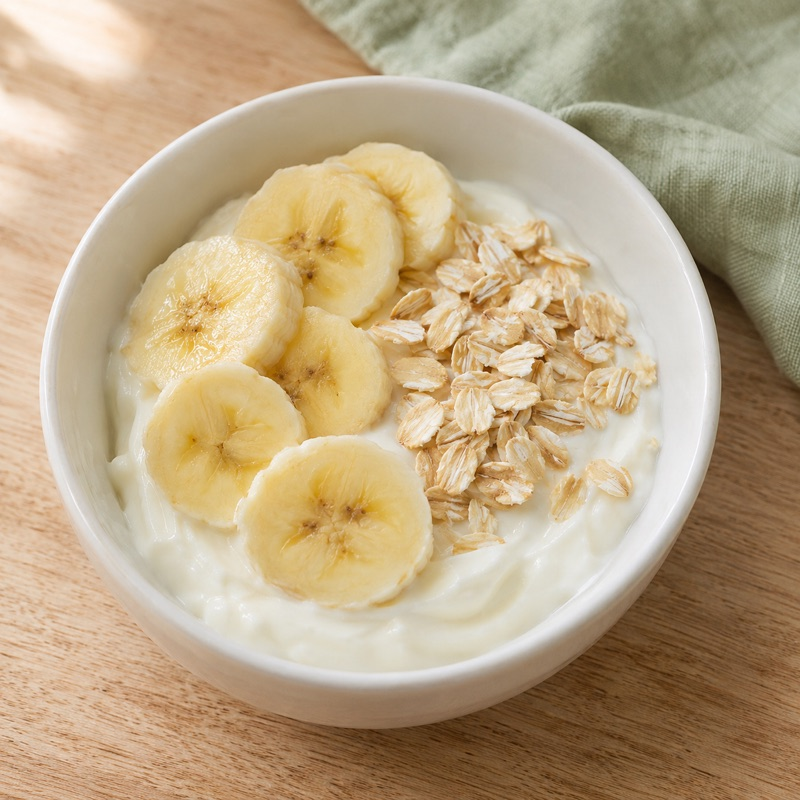
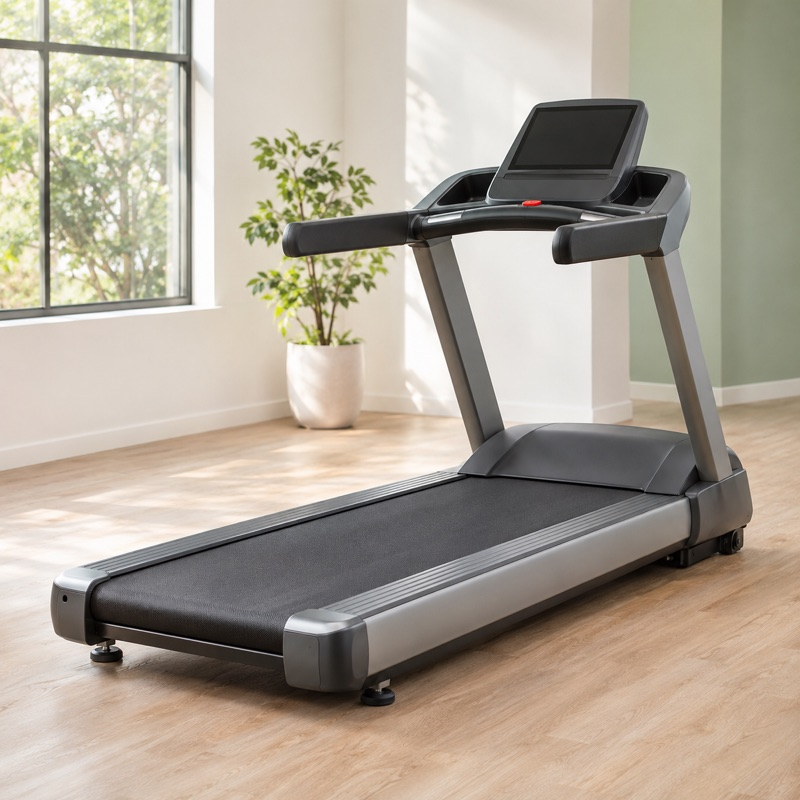
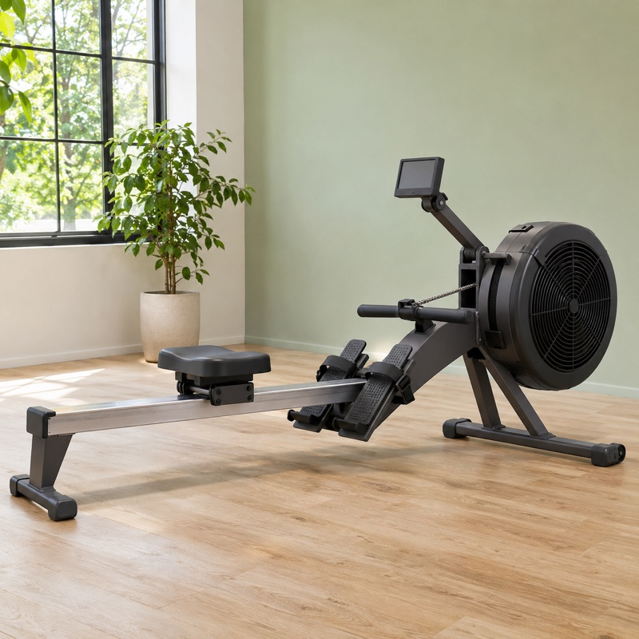
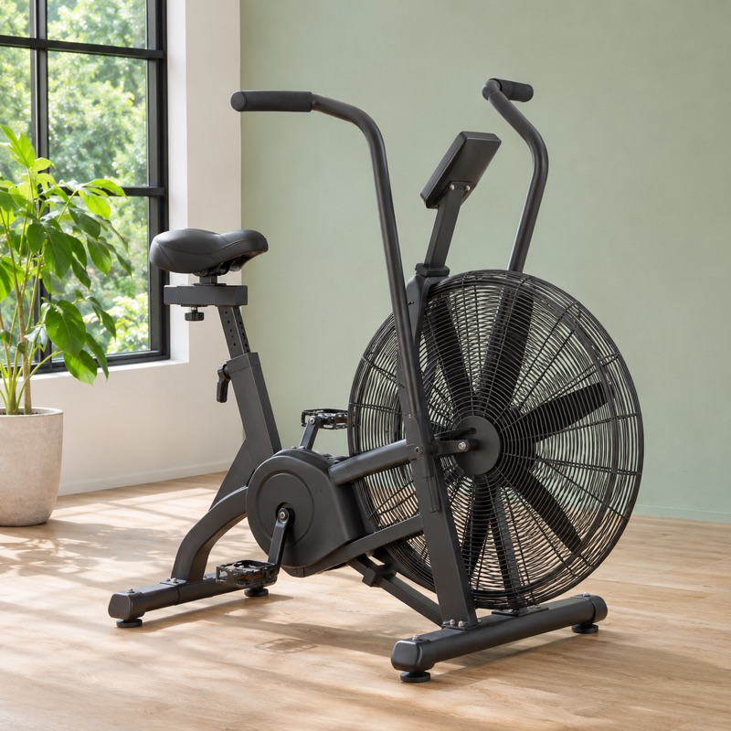
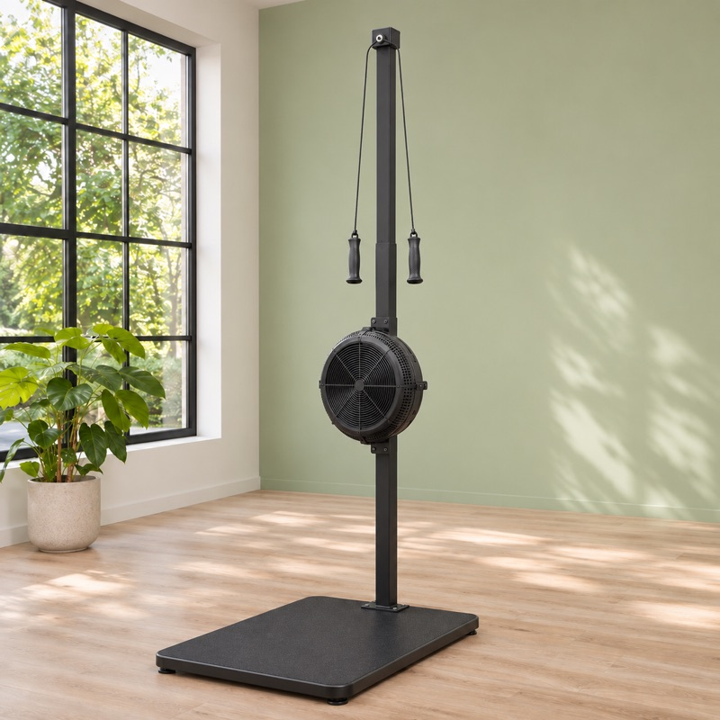

<div align="center">


# FitFood

**今天吃什麼？今天練什麼？一個為減脂而生的 App。**
*What to cook, how to train — one app built for fat loss.*


</div>

---

## ✨ 功能 Features

### 🥗 吃 Food
- **食材轉盤**：依冰箱裡現有的食材，轉出今天能做的菜
- **55 道家常減脂料理**：每道都有完整份量、調味、步驟、熱量與蛋白質
- **今日餐點紀錄**：一鍵記錄、5 秒復原、熱量與蛋白質自動加總
- **食材庫存**：只勾有的，轉盤只出現做得出來的菜

### 🏃 練 Fitness
- **8 種有氧器材 × 24 套減脂課表**：跑步機、爬樓機、橢圓機、飛輪、臥式車、划船機、風扇車、滑雪機
- **每週訓練課表**：以減脂為主、有氧優先，搭配推／拉／腿重訓
- **打卡與連續天數**

### 🌐 其他
- 繁體中文／English 全內容切換（含食譜與課表）
- 資料只存在裝置本機，不上傳任何伺服器
- 可安裝為 PWA

---

## 📸 Gallery

<table>
  <tr>
    <td></td>
    <td></td>
    <td></td>
    <td></td>
  </tr>
  <tr>
    <td></td>
    <td></td>
    <td></td>
    <td></td>
  </tr>
</table>

---

## 🗺️ Roadmap

| 階段 | 內容 | 狀態 |
|---|---|---|
| A1 | 打卡、餐點紀錄、復原、資料驗證、單元測試 | ✅ |
| A3 | 8 種有氧器材、24 套課表 | ✅ |
| M1 + T2 | 早午晚餐分類、早餐菜、目標設定、每日熱量指示器 | 🔄 |
| T1 + T5 | 工程地基、資料匯出／匯入 | ⬜ |
| T3 | 本週菜單＋自動購物清單 | ⬜ |
| T4 | 重訓即時紀錄（重量、次數、休息計時） | ⬜ |
| T6 | 「今天」儀表板首頁 | ⬜ |
| T7 | App Store 上架 | ⬜ |

---

## 🛠️ 開發 Development

```bash
npm install
npm run dev     # http://localhost:5173
npm test        # unit tests
npm run build   # production build
```

**Stack**：React 19 · TypeScript · Vite 8 · Tailwind CSS 4 · Framer Motion · Lucide · Vitest · vite-plugin-pwa

<div align="center">
<sub>Made with 🥦 and 🏋️ in the Bay Area</sub>
</div>
